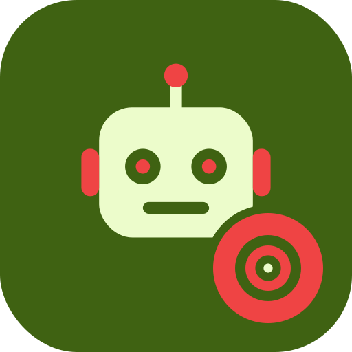

# CS4001 Robocode Reefer

  

Reefer, a Robocode battle robot written for the CS4001 Computer Applications
module, from the LM051 Computer Systems degree at the University of Limerick.

## What it does

- Tracks enemy robots and predicts their position with circular targeting.
- Picks bullet power and tracks fired bullets and their travel time.
- Can draw debug overlays on the battlefield: its own position, enemy current
  and predicted positions, bullet times and the targeting angle.

## Tech

- Java
- [Robocode](https://robocode.sourceforge.io/)

## Running

Build the robot and add it to Robocode's `robots` folder, or point Robocode at
the `robots` folder in this repository, then start a battle.

## License

Licensed under the Apache License 2.0. See [LICENSE](LICENSE).
